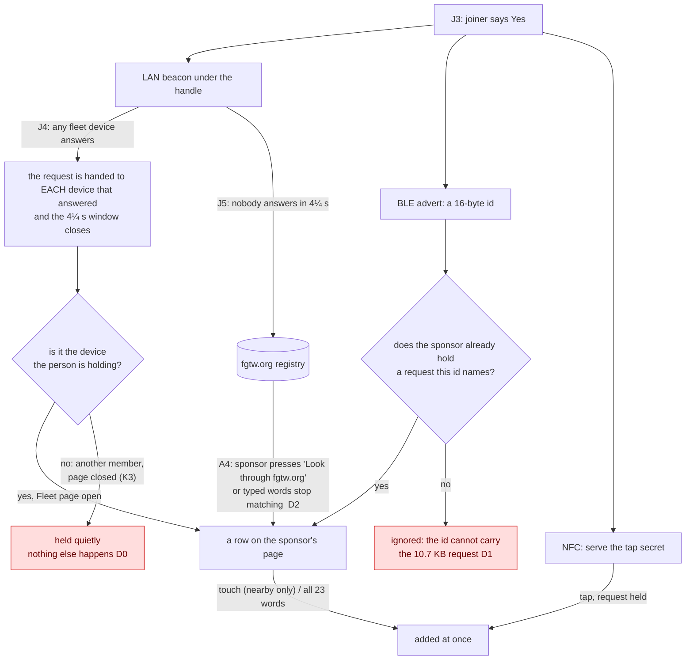
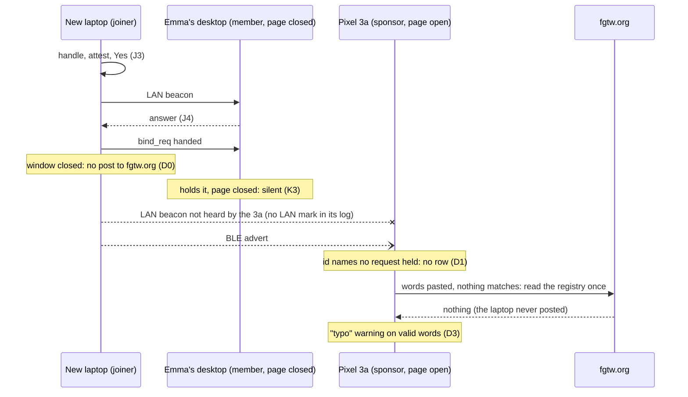
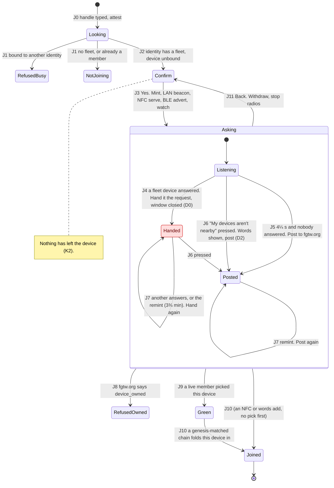
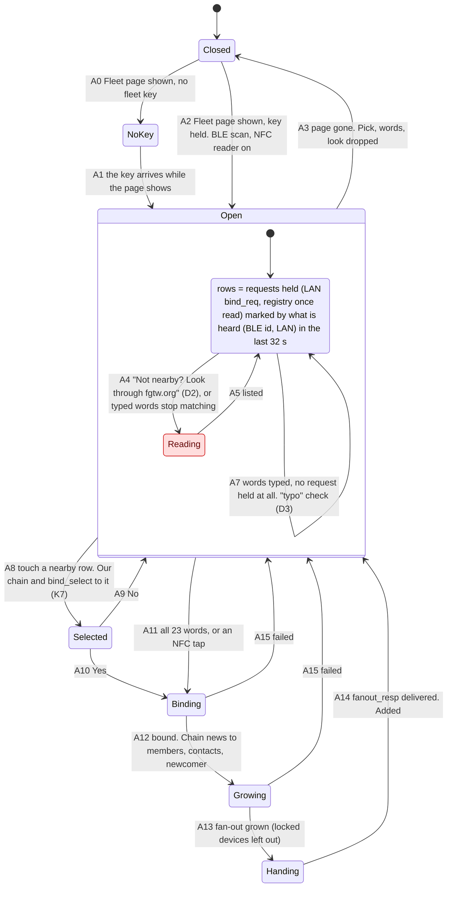
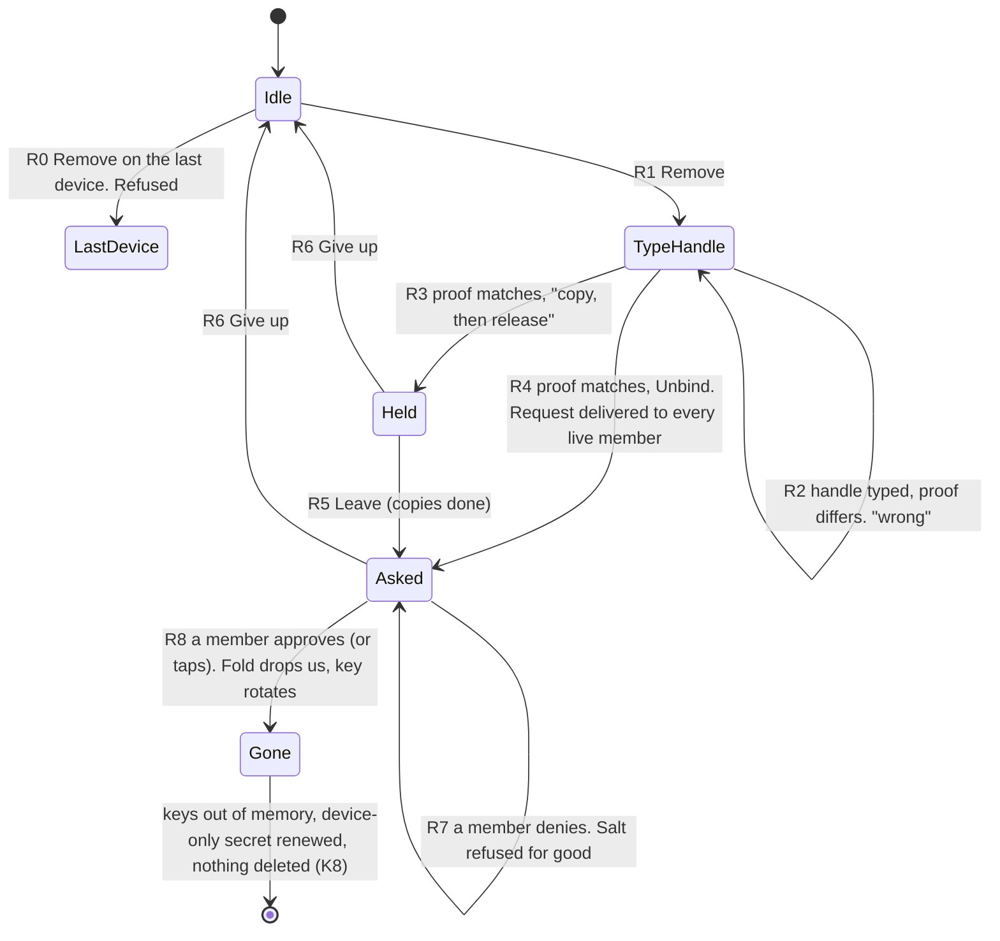

# The fleet graph

Status: **for the owner's review, 2026-11-25.** Drawn from the code as it stands (`src/flow/join.rs`, `add.rs`, `depart.rs`, `sponsor.rs`; photon `ui/photon_app/join.rs`, `devices.rs`, `status.rs`), not from the plans.
Where the code departs from the owner's rules the edge is marked **Dn** and listed under [Departures](#departures).
Nothing here is changed in code until the owner has read it.

The diagrams are Mermaid: plain text in this file, drawn by GitHub, Gitea, VS Code's preview and most Markdown viewers.
Each edge carries an id (J0, A0, R0 …) so a test and a review comment can name it.

## The parties

| Party | Who | Holds |
|---|---|---|
| **Joiner** | the new device, unbound | the identity seed and handle proof (from the typed handle), its own device key, the binding request it mints |
| **Sponsor** | the fleet device the person is holding, Fleet page open | the fleet key, the chain, the requests it has been handed or has read |
| **Other members** | every other device in the fold | the chain; maybe the fleet key; requests handed to them |
| **fgtw.org** | the bootstrap | the registry of binding requests (5 minutes fresh), the one-owner index |

## The rungs (how anything travels, best first)

| Rung | Reach | Carries | Unbound joiner can use it |
|---|---|---|---|
| NFC tap | touching | a 32-byte secret | yes (serve) |
| BLE advert | a room | a 16-byte id, nothing else | yes (advertise) |
| LAN | one network | beacons (UDP 4384), frames, PT transfers | yes |
| WAN peer (mesh, relay pipe) | anywhere | frames, PT | **no**: a device outside the fold has no WAN path yet |
| fgtw.org | anywhere | the registry, chains, the one-owner verdict | yes, the last rung |

## The owner's rules this graph must keep

- **K0** Peers first. fgtw.org only when no peer answers, and then automatically: never a button the person has to find (2026-11-24).
- **K1** Edges, not timers. A machine asks for at most one deadline, with its reason.
- **K2** The handle is typed once. A typed handle never rings a person's devices before the "are you sure?" yes.
- **K3** Deaf ears: a request lights up a device only while its Fleet page is open.
- **K4** Words on screen only behind a press (shoulder surfing).
- **K5** Adding needs the Fleet page open and the fleet key held; one add at a time.
- **K6** Contention (two devices asking) shuts the network path: only a BLE- or NFC-near device can be picked until the add ends.
- **K7** The picked joiner turns green before anything is bound; Yes binds, No drops the pick.
- **K8** Nothing is unbound or destroyed without the handle typed and a member's consent; the last device cannot leave; deleting nothing (2026-11-24).
- **K9** The person is told what is happening in words a person uses: no word-list warnings, no internals.

## Inventory: every lifecycle event

| Event | Machine | Built | Parties | Rungs used today |
|---|---|---|---|---|
| First attest (new identity, genesis) | Attest | in Photon, not a machine | one device, fgtw.org | fgtw.org |
| Join (new device asks) | `flow::join` | yes | joiner → members, fgtw.org | LAN, BLE, NFC, fgtw.org |
| Pick (turn green) | `flow::add` | yes | sponsor → joiner | LAN or WAN |
| Add (bind, grow, hand the key) | `flow::add` | yes | sponsor → joiner, members | LAN, WAN, fgtw.org (the bind) |
| Remove / unbind (leaver asks) | `flow::depart` | yes | leaver → members | LAN, WAN |
| Approve / deny a removal | `flow::depart` | yes | member → fleet | LAN, WAN, NFC |
| Shred (this device's keys) | `security` | yes | one device | none |
| Key rotation (on remove, on own-fold shrink, solo mint) | Photon `fleet.rs` | not a machine | one member → fleet | LAN, WAN, fgtw.org (the fan-out) |
| Lock / revoke / reinstate | Photon `devices.rs` | not a machine | member → fleet | LAN, WAN, fgtw.org |
| Chain news, refold, adoption | Photon `status.rs` | not a machine | any → any | LAN, WAN, fgtw.org |
| Fleet settings, roster | Photon `settings.rs` | not a machine | members | LAN, WAN, fgtw.org backup |
| Profile (name, avatar) | `fgtw::profile` P1 | records yes, flow no | anyone | rides pongs |

This review covers the first five rows. The rest follow once these are straight.

## 0. How a request reaches the sponsor (the whole problem on one page)

Read it as: the request has three ways to the device in the person's hand, and two of them end in a dead end that says nothing.
Once any member on the LAN answers, fgtw.org never gets the request (J4 closes J5), so the only way left is that member, and it is silent by rule (K3).
BLE only confirms a request that came some other way.

## 0a. What happened with Emma, 2026-11-24 (inferred; the laptop's log will confirm)

## 1. Join: the new device (`flow::join`, as built)

| Edge | Today | Rule |
|---|---|---|
| J4 | the first LAN answer cancels the fgtw.org rung for good, whoever answered | K0 (D0) |
| J5 | a 4¼ s silence window, declared in `UNHEARD_OSC` | K1: the one deadline, reason stated |
| J6 | the person has to know to press "My devices aren't nearby: ask through fgtw.org" | K0 (D2) |
| J7 | remint at ¾ of the 5-minute freshness | K1: the protocol's own clock |
| — | the joiner shows "Asking" whether it was handed to a device or not, and never says which | K9 (D4) |

## 2. Add: the sponsor (`flow::add`, as built)

| Edge | Today | Rule |
|---|---|---|
| A4 | fgtw.org is read only on a button or a typing edge; a ready request in the registry stays invisible otherwise | K0 (D2) |
| A6 | the 32 s "nearby" mark lapses on a deadline | K1: one deadline, the earliest lapse |
| A7 | with nothing asking, typed words are checked against the word list and a "typo" is named | K9 (D3) |
| A8 | only a row heard nearby (BLE or LAN) can be touched; a registry-only row needs the words | K6 |
| — | `ListMayHaveChanged` (the hub's poke) re-reads only after a person's look | K0 |

## 3. Remove and unbind (`flow::depart`, as built)

On every other member the same request is `Asked by leaver`: a notification with no page open, Approve or Deny, an NFC tap approves.
No departure found here; it matches the 2026-11-22 and 2026-11-24 rules.

## Departures

| Id | Where | What the code does | Rule | Seen |
|---|---|---|---|---|
| **D0** | `join.rs` LanHeard (J4) | any fleet device answering on the LAN closes the fgtw.org rung; that device holds the request silently (K3), and the device in the person's hand never gets it | K0 | Emma, 2026-11-24 |
| **D1** | `sponsor::candidates` | a BLE advert only marks a request already held; heard alone it makes no row | K0 (BLE is a peer rung that cannot finish) | "the beacon does not work", Emma and Jeff |
| **D2** | `add.rs` A4, `join.rs` J6 | fgtw.org is a button on both sides ("Not nearby? Look through fgtw.org", "My devices aren't nearby: ask through fgtw.org") | K0: automatic, never a button | owner, 2026-11-24 |
| **D3** | `sponsor::match_words` → `first_bad_pair_word` | with nothing asking, typed words are run against the word list and one is called a typo | K9 | owner, 2026-11-24 |
| **D4** | joiner view | "Asking" never says where the request went (handed to which device, posted or not) | K9 | Emma, 2026-11-24 |
| **D5** | joiner | before attest there is no way to send a log | (support) | the laptop's log, 2026-11-24 |

## Proposed fixes, for the owner to choose

**For D0 (the request must reach the device in the person's hand):**
- **P0, peers carry it (recommended).** A member that is handed a request passes it to every other live member over the mesh at once, as it passes chain news. The person's device gets it whether or not it heard the joiner, and fgtw.org is still untouched. "The fleet holds everything." Each member still stays silent unless its page is open (K3).
- **P1, the joiner posts anyway.** fgtw.org gets the request after the window even when a member answered. Simple, but it uses the last rung when a peer did answer.
- P0 and P1 can stack: P0 first, and the joiner posts only when no member acks the hand within the window.

**For D2 (no button):** the sponsor reads fgtw.org on its own on one edge: its page is open, it holds no request, and nothing has been heard nearby. The joiner's "My devices aren't nearby" goes; the words show behind a plain "Show the words" press (K4), which also posts (they are only useful to a remote sponsor).

**For D1:** carry the request itself over a BLE connection (GATT) once the advert is matched by a sponsor with its page open. Not small; it is FLOWS.md's open "join with no shared network" step.

**For D3:** with nothing asking, say "No device is asking to join yet" and drop the word-list check; a word not in the list is named only when the other words already match a device.

**For D4:** the joiner says where the request is: "With Emma's desktop. Open Fleet on it, or on the device in your hand", "Sent through fgtw.org", or "Waiting for your devices".

**For D5:** a "Send log" on the attest screen, signed by the device key alone, accepted by fgtw.org as an unbound device's log.

## Keeping the code and this graph in step

Proposed, not built: each edge id gets a unit test named for it in `src/flow/` (`j4_lan_answer_hands_request`, `a11_full_words_add`), and a gate script checks every id in this file has its test and every such test has its id here.
A change to a machine then shows up as a change to this graph in the same commit.
